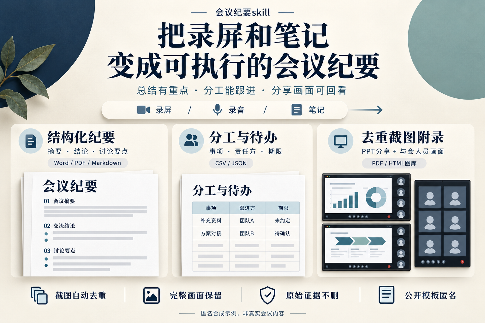

# 会议纪要skill

把录屏、录音和笔记，整理成有重点、可跟进、可回看的会议成果。



## 一眼看懂：你能得到什么

- **快速掌握会议重点**：摘要、结论和讨论要点有结构，提供 Word、PDF 与 Markdown 交付格式。
- **清楚下一步谁来跟进**：事项、责任方、期限一表呈现，CSV / JSON 便于接入后续工作；未确认的信息不猜填。
- **分享内容与人员画面都保留**：PPT、演示和与会人员截图编入附录，自动去重，不重复堆图。
- **复核有依据，公开有边界**：保留原始证据和去重映射；公有模板及展示海报匿名，不混入真实会议资料。

海报为匿名合成格式示意。纪要仍需核对事实，PDF需从已确认的权威稿导出，不代表一键自动完成或获准公开真实会议内容。

## 能力

- 读取录屏、笔记及文档内图片，整理核心议题、交流共识和后续安排。
- 输出正式、简洁的纪要正文，以及包含责任方、期限和交付物的行动清单。
- 提取保留分享内容与人物区域的完整画面截图，建立带时间索引的内部证据包。
- 在本地实际纪要中列示有依据的与会人员，并将PPT、共享内容和人员截图编入附录；公开模板仅使用匿名字段。
- 自动比较分享内容与人员状态，去除重复截图；输出完整原图副本和去重映射，不删除原始证据。
- 使用已有本地模型转写，保留时间戳；结合笔记核对关键事实。
- 区分会议决定、讨论意见与建议，不补写缺失的负责人、期限或承诺。
- 参考Meetily标准模板，采用“摘要—关键决策—行动事项—讨论要点”四段结构；提供可编辑商务版式。
- 处理人工修订后的多格式同步，核对当前权威稿、人员/行动信息和检查报告的版本对应关系。
- 按授权可恢复地清理被替代的旧版交付物，保留原始证据并更新交付索引。

## 使用

将仓库中的 `meeting-minutes` 文件夹安装到 Codex 的 skills 目录。已有同名技能时，先备份并确认更新。

向支持技能的助手提出：

> 使用 $meeting-minutes 读取这份录屏和笔记，制作简洁、正式的会议纪要，包含文字总结、分工、待办与截图附录。

正文采用适合对外交流的行文，详细依据留在内部文件；对外语气不代表资料已经获准发布。

### 本地脚本

需要 Python 3.9+、FFmpeg 和 FFprobe。可选转写依赖 `faster-whisper`、`numpy` 及已经准备好的本地模型，不会自动下载模型。

```bash
python meeting-minutes/scripts/prepare_meeting.py \
  --video meeting.mp4 --notes notes.docx \
  --output .private/evidence --interval 30

python meeting-minutes/scripts/transcribe_local.py \
  .private/evidence/audio-16k.wav .private/transcript \
  --model /path/to/local-model
```

脚本负责材料提取、完整画面抽样和可选本地转写；纪要正文由助手根据技能工作流编写。输出目录必须是新目录，避免覆盖现有资料。

已核对的结构化内容可使用 `node meeting-minutes/scripts/render_minutes.js input.json new-output-directory` 生成Word与Markdown，需要本地 `docx` Node依赖和可用中文字体。输入结构、字体与版式参数见[编辑与排版标准](meeting-minutes/references/editorial-standard.md)。模板不会替用户生成未经核对的会议事实。

截图去重可使用 `python meeting-minutes/scripts/deduplicate_frames.py manifest.json new-output-directory`，需要Pillow、NumPy。支持内容区域比较、分组和经核对的OCR成员集合键；输出仍为完整原画面，原图不删除。字段与阈值说明见[输出契约](meeting-minutes/references/output-contract.md)。

## 隐私

本仓库只包含通用说明、代码与匿名合成海报，不包含真实会议、参会者信息、截图、转写、模型权重或个人路径。提交采用文件白名单，会议产物默认不进入 Git。

公有模板匿名与本地纪要完整性分别处理：模板不含真实个人信息，不意味着应从用户的实际纪要中删除获授权的名单及附录。公开发布任何真实会议资料，仍需独立确认授权。

运行后生成的转写、截图、探测信息和清单可能包含人物、联系方式、文件路径及业务信息，应留在受控环境。对外分发前另行取得授权并检查内容，不直接发布内部证据包。全画面抽样不等于逐帧覆盖，ASR结果仍需核对。

详细结构见[输出契约](meeting-minutes/references/output-contract.md)，方法来源见[开源参考](meeting-minutes/references/open-source-methods.md)。
